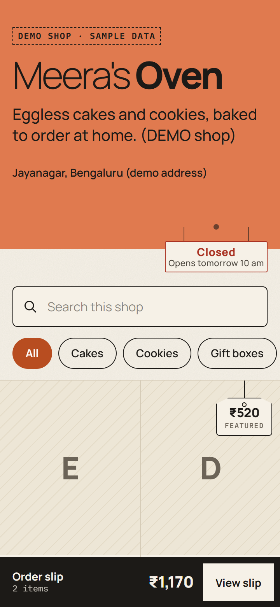
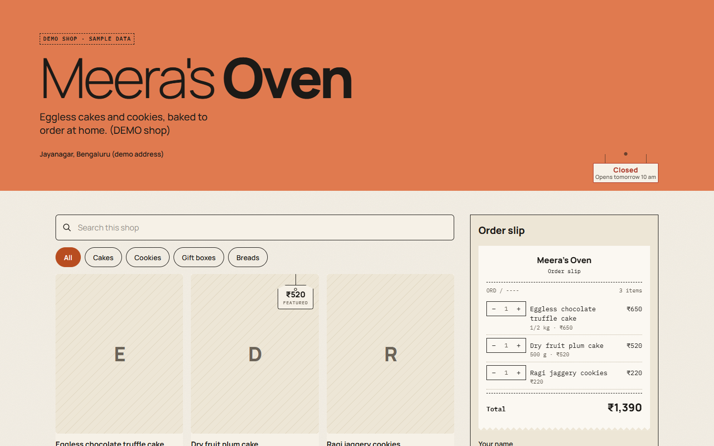
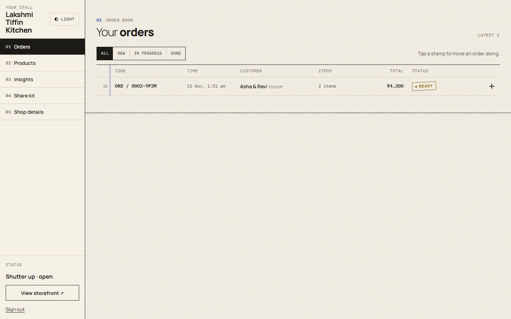
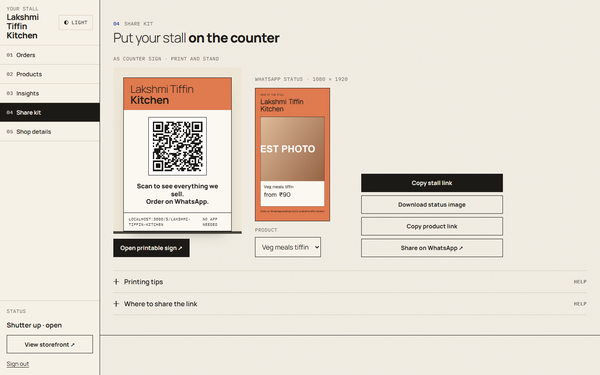
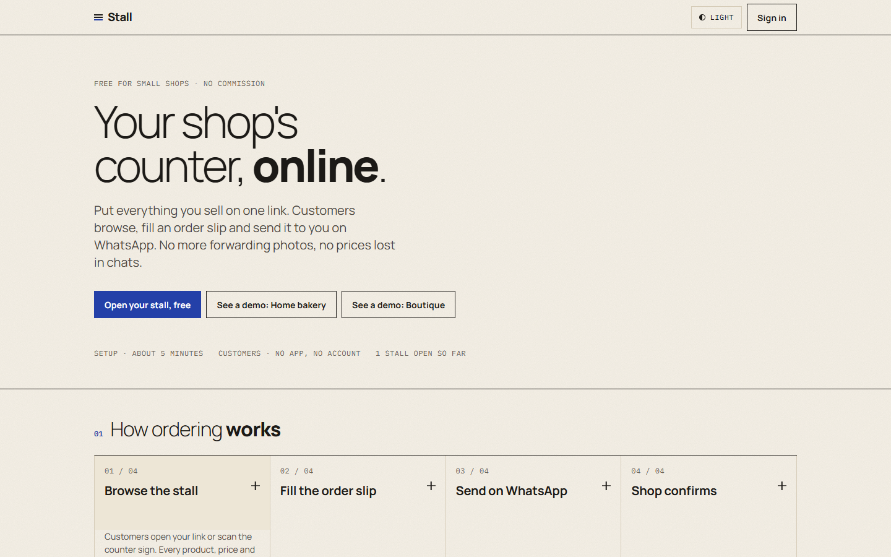
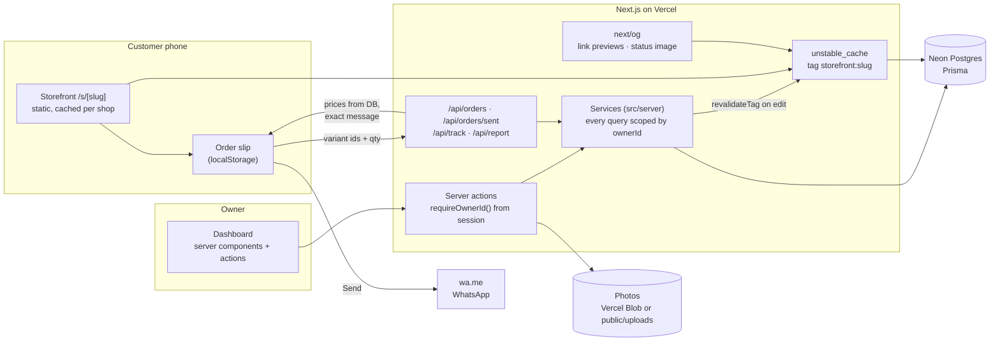

# Stall

A free online catalogue for small Indian shops: customers browse everything you sell on one link and send their order to you on WhatsApp.

**Live demo:** TODO: add the Vercel link after deploying.

## Who is this for and what problem does it solve?

Home bakers, boutiques, kirana stores, tiffin services and handmade sellers who sell through WhatsApp today. Their catalogue lives in status updates and forwarded photos, so customers can't see everything, prices get lost in chats, and orders arrive as messy messages ("2 of the brown one, the 500 rs one?"). Marketplaces are too complicated for a one-person shop and take a commission.

Stall gives each shop a fast storefront at `/s/your-shop`. Customers tap **Add**, fill an order slip and send a neatly formatted order on WhatsApp, with no app or account. The shop gets the same order in a simple order book with a short code like `0142-K7QX`, and stamps it Confirmed, Ready or Delivered.

## Screenshots

Taken from a local build. The bakery is a seeded DEMO shop; the tiffin kitchen is a local test shop.

| Storefront on a phone | Order slip (desktop) |
|---|---|
|  |  |

| Owner order book | Share kit |
|---|---|
|  |  |



## Features

- **Shop setup in about five minutes**, in five numbered steps: name and link, WhatsApp number (validated Indian mobile), products, opening hours, and "open the shutter".
  - **Shop details** covers the logo, banner, address, Google Maps link, pickup and delivery options, and an accent colour that is automatically adjusted to pass WCAG AA contrast.
  - **Storefront language:** English, Hindi, Tamil, Kannada, Telugu or Malayalam.
- **Catalogue:**
  - categories
  - up to 5 photos per product, compressed and resized on the phone before upload, then type- and size-checked on the server
  - sizes, weights or colours as variants
  - stock counts or "made to order", plus an in-stock switch
  - bulk add from a CSV, with a line-by-line preview and errors shown before anything is saved
- **Storefront** (mobile-first and statically cached):
  - search, categories and product pages
  - an order slip that persists in the browser
  - an Open now / Closed board worked out from opening hours in India time
  - a "Report this shop" link
- **Order on WhatsApp:**
  - the customer sees the exact message before sending: items, variants, quantities, total, name, pickup or delivery, and order code
  - Send opens `wa.me` with it pre-filled
  - no WhatsApp API and no fees
- **Order log:**
  - each sent order is saved with a short code; the owner moves it through Confirmed → Ready → Delivered (or Cancelled)
  - tracked stock goes down on confirmation and comes back on cancellation
  - customers can check status with their code
- **Share kit:**
  - a printable A5 QR counter sign
  - a 1080×1920 WhatsApp-status image for any product
  - shareable product links with Open Graph previews (next/og)
- **Owner insights:** storefront views, most-viewed products, WhatsApp orders sent and conversion. Only daily totals are kept: no cookies, no IP addresses.
- **Safety:**
  - every owner query is scoped to the signed-in owner's shop on the server
  - reserved slugs
  - reports and takedown/restore by platform admins (`ADMIN_EMAILS`)
  - anonymous usage counters for "used by N shops"
- **Demo shops:** two seeded shops, a home bakery and a boutique, labelled DEMO everywhere. They show the real message layout but never open WhatsApp.

## Tech stack

Next.js 16 (App Router) · TypeScript (strict) · Tailwind CSS 4 with a custom token layer · PostgreSQL on Neon · Prisma 7 (driver adapter `@prisma/adapter-pg`) · Auth.js v5 credentials provider with bcrypt · zod · `@vercel/blob` · next/og · qrcode · papaparse · Vitest with PGlite (real Postgres in-process for tests).

## Architecture



How an order flows:

1. The browser sends only variant ids and quantities.
2. The server prices them from the database and saves a **preview** order with its code, then returns the exact WhatsApp message.
3. When the customer taps Send, a beacon marks the order as sent (only then does it reach the owner's inbox and count as a WhatsApp order), and the browser opens `wa.me`.

## Design decisions

1. **Orders are saved as previews, then marked sent.**
   - *Why:* the customer sees the exact message, including the real order code, before WhatsApp opens. Abandoned slips never clutter the owner's inbox.
   - *Alternatives:* save the order only when Send is tapped (then the preview can't contain the real code), or don't save orders at all (then there is no order book or status page).
   - *Trade-off:* unsent previews stay in the database (see Limitations).
2. **Integer paise everywhere.**
   - *Why:* prices, line totals and totals are integers in the database (with CHECK constraints) and in code. Rupees exist only in input parsing and display, so ₹0.10 + ₹0.20 rounding bugs can't happen.
   - *Alternative:* `Decimal` columns. They are correct, but clumsier in TypeScript and JSON.
3. **Shop isolation in one place.**
   - *Why:* owner pages and actions take the owner id only from the signed session (`requireOwnerId`). Services look records up with `where: { id, shop: { ownerId } }`, so another shop's id behaves exactly like a missing one. A shop id is never accepted from the browser.
   - *Tests:* run on a real Postgres (PGlite) using the real migrations.
   - *Alternative:* Postgres row-level security. It's stronger, but harder to run with a pooled connection on Neon's free tier.
4. **Static storefront with tag revalidation.**
   - *Why:* `/s/[slug]` and product pages are rendered once and served from cache. Every owner edit calls `revalidateStorefront(slug)`, which expires the `storefront:slug` tag and path, so customers on slow 4G get a cached page while edits still show immediately.
   - *Pushed to the browser:* the open/closed board is computed client-side so the cached HTML never goes stale.
   - *Alternative:* render on every request. That's simpler, but slower and costs database reads on every view.
5. **Storage behind a two-method interface.**
   - *Why:* `PhotoStorage.put/remove`, with Vercel Blob when `BLOB_READ_WRITE_TOKEN` is set and local disk (`public/uploads`, served by `/media/*`) otherwise, so the app runs fully on a laptop without cloud keys.
   - *How files are checked:* photos are compressed on the phone to ~1600 px JPEG. The server checks the real file bytes (magic numbers) and size, never the file name.
6. **A small typed dictionary instead of next-intl.**
   - *Why:* only the storefront is translated, its language is a shop setting (not a URL segment), and there are ~60 strings. A typed `messages(lang)` with English fallback avoids locale routing, which would have fought the per-shop static cache.
   - *Fonts:* each script's Noto Sans font is applied only when the shop uses that language, so other scripts are never downloaded.

## How to run locally

Requirements: Node 20+ and a Postgres database (a free Neon project works).

```bash
cp .env.example .env        # fill in DATABASE_URL, AUTH_SECRET, ADMIN_EMAILS
npm install
npm run db:migrate          # apply migrations
npm run db:seed             # optional: the two DEMO shops
npm run dev                 # http://localhost:3000
```

Other scripts: `npm test` (Vitest; needs no database), `npm run lint`, `npm run typecheck`, `npm run build`.

Without `BLOB_READ_WRITE_TOKEN`, photos are saved to `public/uploads/` (git-ignored).

## Deploy

1. Push the repo to GitHub and import it in **Vercel** (framework: Next.js; build command `npm run build`).
2. Create a **Neon** project and copy the *pooled* connection string.
3. In Vercel → Storage, create a **Blob** store and connect it to the project. This sets `BLOB_READ_WRITE_TOKEN`.
4. Set these environment variables in Vercel (Production and Preview):

   | Variable | Value |
   |---|---|
   | `DATABASE_URL` | Neon pooled URL with `sslmode=require` |
   | `AUTH_SECRET` | `node -e "console.log(require('crypto').randomBytes(32).toString('base64'))"` |
   | `ADMIN_EMAILS` | Comma-separated admin emails |
   | `NEXT_PUBLIC_SITE_URL` | `https://<your-project>.vercel.app` |
   | `BLOB_READ_WRITE_TOKEN` | Set automatically by step 3 |

5. Run the migrations against Neon once from your machine: `DATABASE_URL=<neon url> npm run db:migrate` (and `npm run db:seed` if you want the demo shops).
6. Deploy, open `/signup`, create your stall, then sign in with an `ADMIN_EMAILS` address to reach `/admin`.

TODO: add the live link at the top of this README.

## Limitations and what breaks at scale

- **Rate limits are in-memory per server instance.** On Vercel each instance has its own counters, so a determined attacker spread across instances gets more attempts. Next step: Upstash Redis or Postgres-backed limits.
- **Unsent previews are kept.** A customer who taps "Check my order" but never sends leaves a preview row. They're invisible to owners, but they accumulate; a nightly cleanup of rows with `sentAt IS NULL` older than a day is needed at scale.
- **Order status isn't pushed to anyone.** The owner still replies in WhatsApp, and the customer checks the status page manually.
- **Analytics are approximate.** Views are de-duplicated per browser tab session and counted with one upsert per view. That's fine for small shops; a viral shop would create hot rows, so batch the counts in a queue.
- **The storefront loads the whole catalogue.** It's capped at 500 products per shop. Very large kirana catalogues would need pagination and server-side search.
- **Share images use the default font**, so product names in Indian scripts can render as boxes in link previews and status images. Bundling Noto fonts for next/og would fix it, at the cost of larger functions.
- **Open/closed uses fixed India time** and doesn't know about holidays.
- **Translations need a native-speaker review**, especially Tamil, Kannada, Telugu and Malayalam. WhatsApp messages are always in English so every owner can read them.

## What I learned

- Making a cached page feel live: putting time-dependent UI (the open/closed board) on the client and wiring every owner write to tag revalidation.
- Idempotency in practice: a client-generated key plus a `(shopId, clientKey)` unique constraint, and handling the race when two requests arrive together.
- Animations can't be trusted for control flow. Browsers pause `requestAnimationFrame` in background tabs and battery savers, so the WhatsApp redirect runs on its own timer and every spring has a safety timeout.
- Testing data isolation against a real Postgres (PGlite, in-process, using the real migrations) catches mistakes that mocks would hide.

## What I'd improve next

- WhatsApp click-to-chat follow-ups from the order book ("Your order is ready") using the customer's number from the chat.
- UPI payment links in the message (a `upi://pay` intent with the exact amount).
- Product sorting, bulk price edits and per-variant stock.

## Repo details

- **About:** Free online catalogue for small Indian shops: customers browse and order on WhatsApp. Next.js, Postgres, no commission.
- **Topics:** `nextjs`, `whatsapp`, `small-business`, `prisma`, `india`
